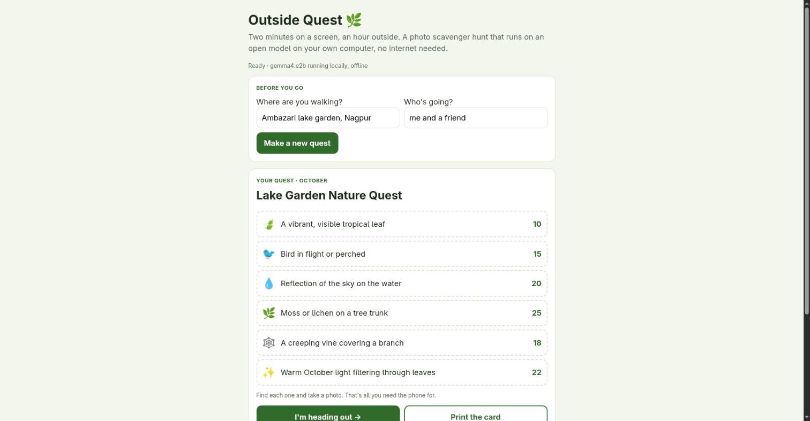
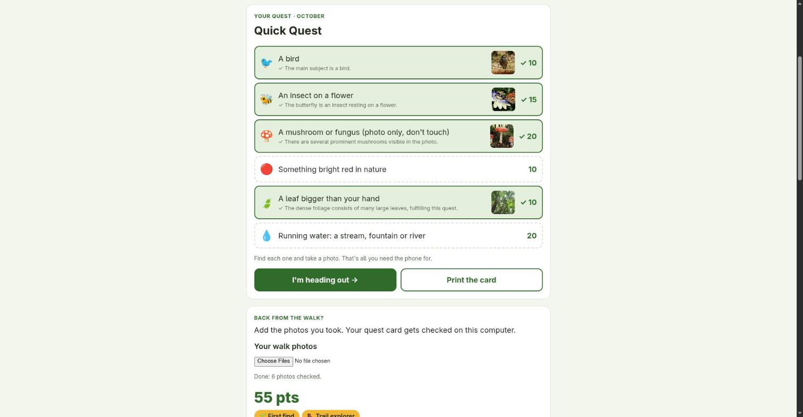
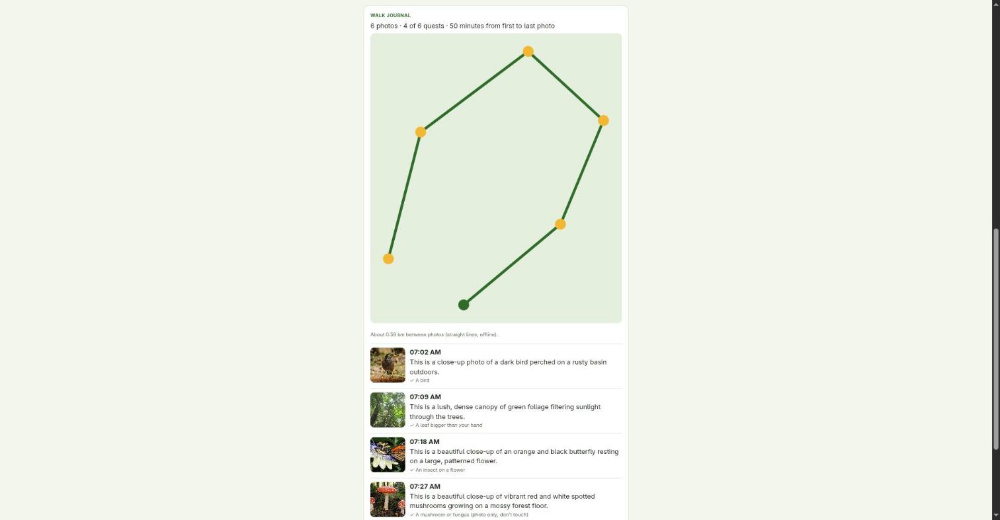

# Outside Quest 🌿

**Two minutes on a screen, an hour outside.** An offline photo scavenger hunt powered by Google's open-weight
**Gemma 4**, running on your own computer with [Ollama](https://ollama.com).

1. **Before you go:** tell it where you're walking. Gemma writes a 6-item quest card that fits the real local
   season ("a seed pod on the ground" in tropical Nagpur in October, "crimson leaves under an oak" in New York).
   Print it or glance at it once.
2. **On the walk:** phone in your pocket. You only take it out to snap a photo of each find.
3. **Back home:** drop in your photos. Gemma checks which quests each photo completes, with the visible evidence,
   and builds a walk journal: a timeline from the photos' timestamps and a little route map from their GPS tags.

No account, no upload, no internet needed. Your photos (and their location data) never leave the computer.







## Run it

```bash
ollama pull gemma4:e2b          # ~4.6 GB; gemma4:e4b also works if you have the memory
pip install -r requirements.txt # Pillow, for EXIF + resizing
python3 server.py               # open http://127.0.0.1:8777
```

Tested on a laptop with a 6 GB GTX 1660 Ti: a quest card takes ~30 s, checking a photo ~25-35 s.
Settings: `QUEST_MODEL`, `QUEST_OLLAMA_URL`, `QUEST_HOST`, `QUEST_PORT`.

## Why a scavenger hunt and not a species identifier

I first built a plant/bird identifier. Then I tested it. On six photos, `gemma4:e2b` called a Common Myna a
"Jackdaw" with **high** confidence, and `gemma4:e4b` called it a "Weaver Bird", also with high confidence.
Neither named the Monarch butterfly or the neem tree; asking for a top-3 list didn't fix it. A tool that tells
you the wrong bird with confidence is worse than no tool.

But both models were reliably right about the **coarse** question: *is there a bird? a butterfly on a flower?
a mushroom? a storm cloud?* So the app asks the model only what small open models are good at, and leaves the
naming to you and a field guide. On the six test photos, every main subject was matched to the right quest.

## Safety, in code

Quests written by the model pass through plain-code filters before you see them:

- anything involving climbing, water entry, touching, picking, eating, feeding or chasing animals, roads,
  railway tracks, private land or going out at night is dropped and replaced from a safe built-in pool;
- mushrooms, berries, nests and eggs always get "(photo only, don't touch)" added;
- if the model is down or returns junk, the card is filled from the same safe pool.

A completed quest must come with a non-empty description of the visible evidence, and quest IDs are constrained
with a JSON schema, so the model can't invent quests or award points without saying why.

## How it's built

- `server.py`: Python standard library plus Pillow. Two endpoints: `/api/quests` (structured-output quest card)
  and `/api/check` (reads EXIF time + GPS, resizes to 1024 px, asks Gemma which quests the photo completes).
- `static/index.html`: one file, no framework. Quest card, a full-screen "phone away" timer, results board,
  badges, journal and an SVG route drawn from the photos' coordinates (no map tiles, so it works offline).

## Sample photos

`samples/` holds six Wikimedia Commons photos used for testing (credits in `samples/CREDITS.md`).
`samples/demo-walk/` holds the same photos with **made-up** timestamps and GPS points, only to demo the journal.

## License

MIT
